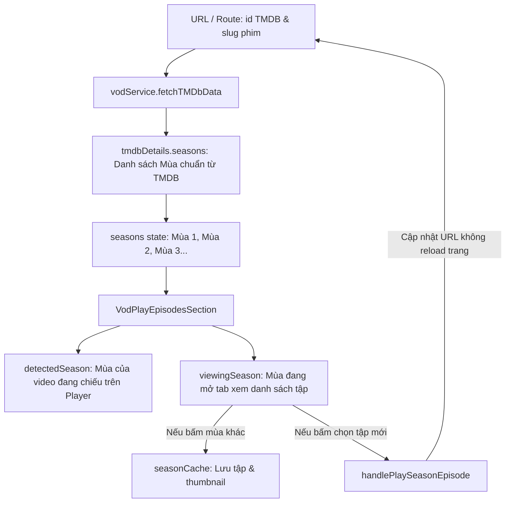
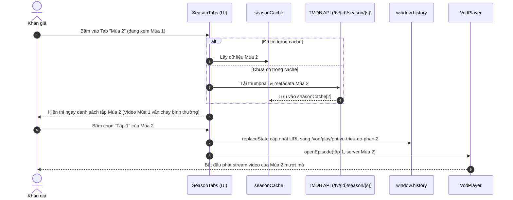

# KIẾN TRÚC & CƠ CHẾ XỬ LÝ SEASON (TMDB STANDARDIZATION)

> **Mục tiêu:** Quản lý vòng đời và danh sách Season chuẩn xác 100% qua TMDB API (`/tv/{id}`), xóa bỏ hoàn toàn anti-pattern lạm dụng endpoint tìm kiếm (`api/tim-kiem`), mang lại trải nghiệm xem phim mượt mà và tối ưu hiệu năng.

---

## 1. Nguyên tắc cốt lõi: 100% TMDB cho Season & Detail

### Sai lầm trước đây (Anti-pattern):
- Trước đây, khi cố gắng gom các phần liên quan của phim Việt, code cũ đã dùng endpoint `v1/api/tim-kiem?keyword=...` để hy vọng tìm được các phần khác theo từ khóa tên phim.
- **Tại sao SAI hoàn toàn?**
  1. `api/tim-kiem` là endpoint phục vụ **thanh tìm kiếm (Search Bar)** khi người dùng nhập từ khóa, không phải endpoint lấy chi tiết (Get Detail).
  2. Dữ liệu từ `tim-kiem` chỉ là danh sách tóm tắt, không có cấu trúc mùa (Season), không có danh sách tập đầy đủ hay metadata chi tiết.
  3. Gây lãng phí băng thông và bắn request thừa thãi vô nghĩa lên server mỗi khi khán giả mở trang xem phim.

### Kiến trúc chuẩn hiện tại (Chuẩn hóa TMDB):
- Mọi thông tin Season, danh sách mùa, số tập mỗi mùa, poster và ảnh thumbnail từng tập được lấy **trực tiếp 100% từ TMDB API**:
  - `GET /tv/{tmdbId}` $\rightarrow$ Trả về `details.seasons` chuẩn quốc tế.
  - `GET /tv/{tmdbId}/season/{seasonNumber}` $\rightarrow$ Trả về ảnh thumbnail `still_path`, tên tập, runtime và diễn viên của từng tập.
- Tuyệt đối **KHÔNG gọi `api/tim-kiem`** trong toàn bộ luồng Play / Detail / Season.

---

## 2. Mô hình phân tầng State tại Player

Hệ thống tách biệt rõ ràng 3 khái niệm Season để kiểm soát luồng hiển thị:



### Chi tiết các biến State:

| Tên biến / State | Vị trí định nghĩa | Ý nghĩa nghiệp vụ |
| :--- | :--- | :--- |
| `seasons` | `useMovieDetail.js`, `useVodPlayLogic.js` | Mảng chứa danh sách các Season chuẩn được lấy từ `tmdbDetails.seasons`. |
| `detectedSeason` (hoặc `playingSeason`) | `useSeasonDetection(movie)` tại `Play.jsx` | Số mùa của video **đang được phát trực tiếp** trên Player (hiển thị badge nhấp nháy `[ĐANG PHÁT]`). |
| `viewingSeason` | `VodPlayEpisodesSection.jsx` | Số mùa mà người dùng **đang click tab xem danh sách tập bên dưới**. Đổi tab mùa không làm ngắt video đang xem. |
| `seasonCache` | `VodPlayEpisodesSection.jsx` | Bộ nhớ đệm lưu `episodes`, `movie`, `imdbEpisodes` của các mùa đã duyệt qua, giúp chuyển tab tức thì trong 0ms. |

---

## 3. Cơ chế trích xuất Season từ TMDB

Tại hook `useMovieDetail.js`, hàm `applyTmdbSeasons` nhận trực tiếp `tmdbDetails.seasons` từ TMDB:

```javascript
// File: src/hooks/useMovieDetail.js
const applyTmdbSeasons = (tmdbDetails, baseSlug, foundTmdbId, setSeasons) => {
    if (!tmdbDetails?.seasons || tmdbDetails.seasons.length === 0) return;
    const cleanSlug = cleanBaseSlug(baseSlug);
    
    // Lọc bỏ season 0 (Specials/Hậu trường) và map thành danh sách season chuẩn
    const tmdbSeasonsList = tmdbDetails.seasons
        .filter((s) => s.season_number > 0)
        .map((s) => ({
            season: s.season_number,
            name: s.name || `Mùa ${s.season_number}`,
            episodeCount: s.episode_count,
            posterPath: s.poster_path,
            slug: s.season_number === 1 ? cleanSlug : `${cleanSlug}-phan-${s.season_number}`,
            tmdbId: foundTmdbId,
        }));

    if (tmdbSeasonsList.length > 1) {
        setSeasons(tmdbSeasonsList);
    }
};
```

---

## 4. Cơ chế Load Thumbnail & Dữ liệu tập từng Mùa

Khi khán giả chuyển đổi tab mùa trong `VodPlayEpisodesSection`:

1. **Kiểm tra Season Cache**: Nếu mùa đã được tải trước đó, lấy ngay từ `seasonCache[seasonNumber]` trong 0ms.
2. **Tải dữ liệu tập từ 2 nguồn chuyên biệt**:
   - Nguồn phát Stream (PhimAPI/KKPhim): Gọi theo slug tương ứng của mùa (`vodService.fetchSourceData(seasonItem.slug)`).
   - Nguồn Metadata & Thumbnail: Gọi TMDB Season API (`vodService.fetchTMDBSeason(tmdbId, seasonNumber)`).
3. **Khớp nối dữ liệu thông minh (`computeEpisodeListData`)**:
   - Khớp `episode_number === epNum` để lấy thumbnail `still_path`.
   - Fallback an toàn lấy theo thứ tự index `imdbEpisodes[i]` nếu nguồn phát đánh số tập lũy kế.
   - Tuyệt đối không hardcode ID, không gọi search API.

---

## 5. Luồng tương tác người dùng (User Interaction Workflow)



---

## 6. Tiêu chuẩn cam kết chất lượng

- [x] **Zero Search in Play/Detail**: Không còn bất kỳ request nào tới `api/tim-kiem` trong toàn bộ luồng xem phim.
- [x] **100% TMDB Standards**: Seasons và metadata tập phim được lấy chính thống từ TMDB.
- [x] **No Gradient Rule**: Giao diện chỉ sử dụng màu solid chuẩn (`bg-red-600`, `bg-zinc-900`, `border-zinc-800`).
- [x] **In-place Browsing**: Đổi season duyệt danh sách tập không ngắt video đang phát.
- [x] **SonarQube Clean**: 0 lỗi lint, độ phức tạp tính toán `<= 15`.
